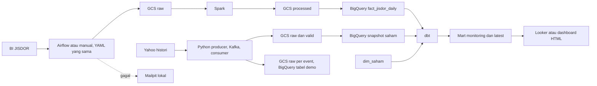
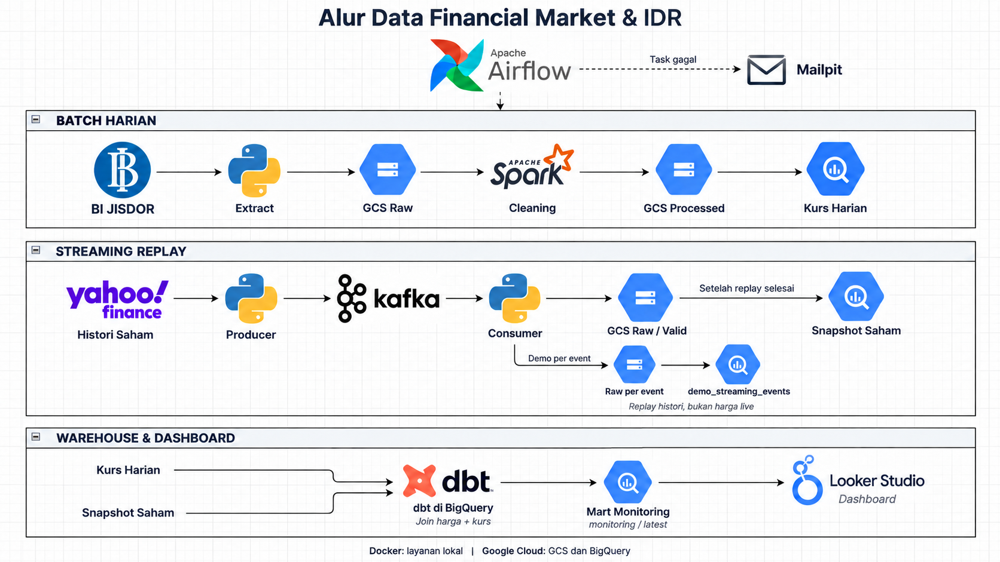

# Financial Market & IDR Exposure Monitoring

Portofolio Data Engineering, Daud Fernando, Purwadhika JCDEAH-009.

Pipeline menggabungkan histori empat saham finansial AS dengan kurs BI JISDOR untuk memantau nilai indikatif dalam rupiah. Pengguna analitik dapat membandingkan saham, melihat pengaruh harga dan kurs, serta menelusuri asal angka di dashboard.

## Cakupan data

| Data | Sumber dan grain | Kegunaan |
|---|---|---|
| Kurs USD/IDR | BI JISDOR, tanggal dan mata uang | Konversi nilai ke rupiah |
| JPM, BAC, GS, MS | Yahoo Finance melalui yfinance, bar satu menit | Histori harga dan perbandingan saham |
| Referensi saham | Daftar manual empat emiten, satu baris per symbol | Nama perusahaan dan mata uang |
| Mart analitik | Harga, kurs dan dimensi saham | Nilai per saham, return dan sinyal simulasi |

Harga menggunakan histori asli yang dikirim ulang melalui Kafka. Ini bukan feed harga live. Quantity satu saham; sinyal SMA3/SMA8 adalah simulasi aturan, bukan hasil backtest atau rekomendasi investasi. Ketersediaan tanggal mengikuti sumber, termasuk akhir pekan dan hari libur.

## Alur



Replay snapshot memuat GCS setelah seluruh pesan selesai, lalu dbt membangun mart. Demo per event melakukan streaming insert ke tabel terpisah; tabel tersebut tidak otomatis memperbarui mart dashboard.



## Struktur

```text
jalankan.py                     satu entry point command
config/pipeline_kurs.yaml        task ID, parameter, dependensi dan jadwal
operator_pipeline/              operator Airflow, eksekusi, koneksi, GCS, BigQuery, alert
scripts/
  ekstraksi/                    ambil kurs dan histori saham
  transformasi/                 bersihkan kurs dengan Spark
  pemuatan/                     simpan sumber dan muat warehouse
  streaming/                    kontrak event, producer, consumer dan replay
  pipeline/                     orkestrasi persiapan dan replay lengkap
  validasi/                     rekonsiliasi, cakupan tanggal dan mart
  persiapan/                    konfigurasi lokal dan bucket
  laporan/                      ekspor dashboard, Excel dan dbt Docs
analytics/models/               silver, dimensi, gold dan pengujian dbt
airflow/                        DAG dan image Spark
```

Semua task kurs menggunakan `OperatorKurs`; fungsi bisnis tidak ditulis ulang di DAG. Nama model BigQuery dipertahankan agar koneksi dashboard tetap kompatibel.

## Setup, Windows PowerShell

Prasyarat: Python 3.11 atau lebih baru, Docker Desktop dengan Linux containers, Google Cloud CLI dan akses GCS/BigQuery pada project yang dikonfigurasi. Spark dijalankan dalam container Airflow. Resource cloud memakai `jcdeah-009`, region `asia-southeast2`; repository publik tidak memberikan izin mengakses project tersebut.

```powershell
python -m venv .venv
.\.venv\Scripts\python.exe -m pip install -r requirements.txt
gcloud auth application-default login
.\.venv\Scripts\python.exe jalankan.py siapkan-airflow
docker compose --env-file .env.airflow -f compose.yaml -f compose.streaming.yaml -f compose.analytics.yaml --profile streaming --profile analytics build airflow market dbt
docker compose --env-file .env.airflow -f compose.yaml -f compose.streaming.yaml -f compose.analytics.yaml --profile streaming --profile analytics up -d --wait airflow kafka
```

Jika bucket belum tersedia, buat dengan `jalankan.py siapkan-bucket --project jcdeah-009 --bucket jcdeah-009-daud-finalproject --use-local-adc`. Periksa izin dan konfigurasi sebelum menggunakan project milik sendiri. `.env.airflow` dan credential dibuat/disimpan lokal, bukan di Git.

## Menjalankan pipeline

| Tujuan | Command PowerShell |
|---|---|
| Perbarui sumber sampai mart | `.\.venv\Scripts\python.exe jalankan.py siapkan-data` |
| Hanya perbarui arsip saham | `.\.venv\Scripts\python.exe jalankan.py ambil-saham --activate` |
| Replay lengkap sampai mart | `.\.venv\Scripts\python.exe jalankan.py replay-lengkap` |
| Batch manual di container Spark | `docker compose --env-file .env.airflow -f compose.yaml exec -T airflow python jalankan.py batch` |
| Baca tiga pesan Kafka | `.\.venv\Scripts\python.exe jalankan.py lihat-kafka` |
| Audit mart | `.\.venv\Scripts\python.exe jalankan.py periksa-mart --use-local-adc` |
| Dokumentasi lineage | `.\.venv\Scripts\python.exe jalankan.py lihat-lineage --refresh` |

Jalankan satu persiapan pada satu waktu. `siapkan-data` mengambil sumber, menunggu DAG batch sukses, lalu menjalankan replay dan dbt. Pipeline berhenti jika tahap wajib gagal.

Replay per event, setelah setup data awal selesai:

```powershell
docker compose --env-file .env.airflow -f compose.yaml -f compose.streaming.yaml --profile streaming run --rm market /workspace/jalankan.py replay-event --limit 40 --interval 2
```

Transformasi manual satu run memakai fungsi yang sama dengan task Airflow:

```powershell
docker compose --env-file .env.airflow -f compose.yaml exec -T airflow python jalankan.py batch --task transform_spark --run-id SOURCE_RUN_ID
```

SOURCE_RUN_ID harus berasal dari pengambilan yang valid dan raw GCS sudah diunggah. Mode otomatis: DAG `jisdor_daily`, pukul 18.00 WIB selama container aktif dan DAG tidak paused. Cara menguji alert terdapat pada dokumentasi batch.

## Dokumentasi

- [Standar modul, error dan pengembangan](docs/standar_pengembangan.md)
- [Batch manual dan otomatis](docs/bigquery_batch.md)
- [Streaming dan bukti ingestion per event](docs/streaming_ingestion.md)
- [Medallion, grain dan lineage](docs/medallion_bronze_silver_gold.md)
- [Transformasi dan penggunaan mart](docs/demo_analytics.md)
- [Definisi sinyal](docs/stock_signals.md)

## Pengujian

```powershell
.\.venv\Scripts\python.exe -m pip install -r requirements-dev.txt
.\.venv\Scripts\python.exe -m unittest discover -s tests -v
.\.venv\Scripts\python.exe -m ruff check .
docker compose --env-file .env.airflow -f compose.yaml exec -T airflow python -m unittest discover -s tests -p test_spark_batch.py -v
docker compose --env-file .env.airflow -f compose.yaml -f compose.analytics.yaml --profile analytics run --rm dbt build
```

Unit test lokal tidak memerlukan credential cloud. Test Spark berjalan di container; dbt build memerlukan akses BigQuery. Validasi meliputi kontrak event, hash raw, deduplikasi, jumlah load, kegagalan sink, rekonsiliasi dan penghentian task lanjutan saat error.

## Akses hasil

- [Airflow](http://localhost:8085), [Mailpit](http://localhost:8025), [dbt Docs](http://localhost:8086).
- [BigQuery](https://console.cloud.google.com/bigquery?project=jcdeah-009), dataset `daud_finalproject` dan `daud_finalproject_demo`.
- Dashboard HTML: `dashboard/index.html`, data dibuat ulang melalui pipeline.
- Looker: hubungkan `mart_stock_monitoring` untuk histori dan `mart_stock_latest` untuk status terakhir. URL report belum disertakan.

Credential, data lokal, hasil ekspor dan catatan presentasi tidak dipublikasikan. PostgreSQL adalah metadata Airflow; ingestion tabel bisnis PostgreSQL dan scraping HTML tidak termasuk implementasi saat ini. Dataflow tidak digunakan. Histori menit Yahoo memiliki batas ketersediaan; arsip lokal diperlukan untuk replay tanggal lama. Publikasi kode tidak memindahkan hak data pihak ketiga.

Sumber: [BI JISDOR](https://www.bi.go.id/biwebservice/wskursbi.asmx?op=getSubKursJisdor3), [Yahoo Finance](https://finance.yahoo.com/), [yfinance](https://ranaroussi.github.io/yfinance/).
