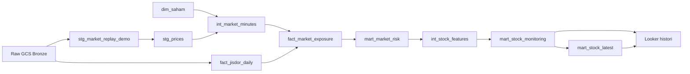

# Medallion dan lineage data

Medallion adalah pembagian layer pengolahan secara logis. Folder model dbt mengikuti Silver, dimensi dan Gold; raw Bronze tetap berada di GCS. Tidak ada klaim tiga dataset fisik atau star schema lengkap.

| Layer | Data | Grain dan key |
|---|---|---|
| Bronze | XML BI, envelope Kafka dan sumber saham | Source run, topic/partition/offset |
| Silver | fact_jisdor_daily, stg_prices, int_market_minutes | Tanggal+currency; event_id; saham/mode/jenis/menit |
| Dimensi | dim_saham | Satu baris per symbol, referensi manual empat perusahaan |
| Gold | fact_market_exposure, mart_market_risk, int_stock_features, mart_stock_monitoring, mart_stock_latest | Exposure per event; monitoring per saham/mode/jenis/menit; latest per saham/mode/jenis |

`int_stock_features` berada di folder Silver sebagai transformasi fitur yang digunakan Gold; dependensinya tetap mengikuti ref(), bukan nama folder. Layer tidak mengubah urutan SQL yang diperlukan.

## Mengapa dbt

Model SQL, dependency `ref()`/`source()`, test dan dokumentasi berada dalam satu project yang bisa direview dan dijalankan ulang. dbt menentukan urutan pembangunan dari graph, bukan urutan script manual. BigQuery tetap menjadi mesin eksekusi SQL; dbt bukan penyimpanan baru.

Dimensi manual menjelaskan symbol dan company_name. Harga per menit terhubung ke dim_saham berdasarkan symbol dan currency. Exposure memilih kurs USD terakhir yang tersedia pada waktu observasi. Jika waktu publikasi kurs tidak diketahui, gunakan tanggal kurs sebelum event WIB. LEFT JOIN mempertahankan harga tanpa kurs agar missing FX terdeteksi, bukan hilang diam-diam.

## Batasan

- Demo per-event memakai tabel/view demo_streaming_events dan bukan input mart utama.
- demo_signal_scenarios hanya fixture sintetis pengujian, tidak bercampur dengan data pasar.
- View jisdor_date_coverage adalah audit, bukan dimensi kalender bisnis.
- Nama model warehouse tetap sama; perpindahan folder tidak memerlukan perubahan koneksi Looker.
